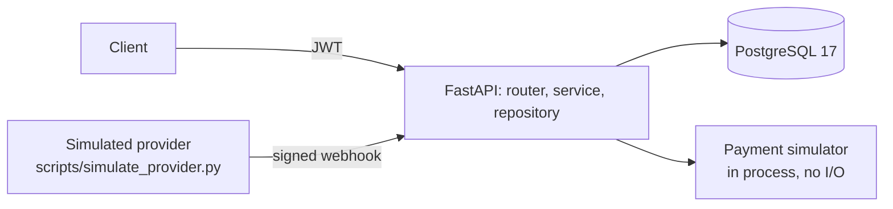
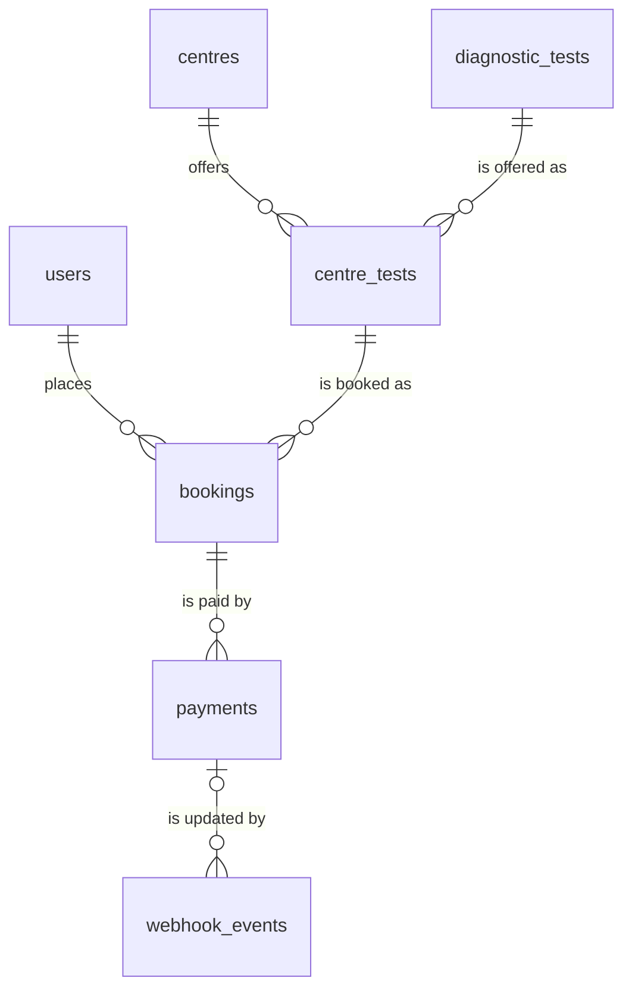

# EVE Healthcare: diagnostic bookings and simulated payments

A backend service for diagnostic-test bookings. Patients sign up, browse centres and their test
prices, book a test, and pay with a simulated provider. The provider reports the result by a signed,
idempotent webhook. It is Python, FastAPI and PostgreSQL, with 24 endpoints, and one design goal:
the money and the booking never disagree, even when requests repeat or race.



- **Architecture and the reasons behind it:** [docs/ARCHITECTURE.md](docs/ARCHITECTURE.md)
- **Performance at 100,000 bookings:** [docs/perf.md](docs/perf.md)
- **Live API documentation:** `http://localhost:8000/docs` once the service runs

---

## 1. How to run it locally

### With Docker (the shortest path)

```bash
docker compose up --build
```

Then open <http://localhost:8000/docs>. The stack starts PostgreSQL, applies the migrations, seeds
an admin and a sample catalog, and starts the API. It needs no `.env` file.

- If port 8000 is busy, run `API_PORT=8080 docker compose up --build`.
- The seeded admin is `admin@example.com` with the password `dev-only-admin-password`. These are
  development values from the compose file. Never use them in production. The application refuses
  them, and every other placeholder secret, when `ENVIRONMENT=production`.
- The sample catalog has 5 centres, 12 tests and 30 prices.

### Without Docker

You need Python 3.12 or newer and a PostgreSQL 17 database.

```bash
uv sync                          # or: python -m venv .venv && . .venv/bin/activate && pip install -r requirements-dev.txt
cp .env.example .env             # development values; edit DATABASE_URL if your database differs
make db                          # starts PostgreSQL in Docker with its port published (skip it if you have your own)
uv run alembic upgrade head      # create the tables
uv run python -m scripts.seed    # the admin and the sample catalog (safe to run again)
uv run fastapi dev               # http://localhost:8000/docs, with reload
```

With your own PostgreSQL, create a role with `CREATEDB` and an empty database, then set
`DATABASE_URL` and `TEST_DATABASE_URL` in `.env`. The test fixture creates the `eve_test` database.

### Tests

```bash
make test                                         # on the host, needs `make db` (or your own PostgreSQL)
docker compose --profile test run --rm test       # with Docker only
make check                                        # lint, types and tests: the gate before every commit
make coverage                                     # tests with the coverage gates (85% overall, 90% for the logic)
```

---

## 2. API endpoints and example requests

Every error is `application/problem+json` (RFC 9457). Switch on the `code` field. Money is a decimal
string, and times are ISO 8601 with an offset. Each collection answers both `/centres/` and
`/centres` without a redirect, and lists take `?limit=` (1 to 100) and `?offset=`.

| Method and path | Who | What it does |
|---|---|---|
| `POST /auth/signup` | anyone | Create a patient account. The password needs 15 or more characters. |
| `POST /auth/login` | anyone | Log in with JSON, get a token. |
| `POST /auth/token` | anyone | The same with the OAuth2 form, for Swagger's **Authorize** button. |
| `GET /users/me` | user | The signed-in user. |
| `GET /centres/` | anyone | List active centres. Filters: `city`, `test_id` (adds the price), `q`. |
| `GET /centres/{id}` | anyone | One centre with the tests it offers and their prices. |
| `POST /centres/` | admin | Create a centre. |
| `PATCH /centres/{id}` | admin | Change some fields, or restore a deactivated centre. |
| `DELETE /centres/{id}` | admin | Deactivate a centre (rows are never deleted). |
| `PUT /centres/{id}/tests/{test_id}` | admin | Set the price of a test at a centre. `201` when new, `200` when replaced. |
| `GET /tests/`, `GET /tests/{id}` | anyone | List and read diagnostic tests. |
| `POST /tests/`, `PATCH /tests/{id}`, `DELETE /tests/{id}` | admin | Manage the test catalogue. |
| `POST /bookings/` | user | Book a test at a centre. The price is copied from the centre's price. |
| `GET /bookings/` | user | My bookings, newest first. |
| `GET /bookings/{id}` | owner | One booking with its payments. |
| `POST /bookings/{id}/cancel` | owner | Cancel a booking. A repeat answers `200` and changes nothing. |
| `POST /payments/` | owner | Pay a booking with the simulator. A repeat returns the same payment. |
| `GET /payments/{id}` | owner | One payment. |
| `POST /payments/webhook/` | provider | Receive a signed payment event. Safe to repeat. |
| `GET /health/live`, `GET /health/ready` | anyone | Probes. |

### One flow, from sign-up to a confirmed booking

Copy and paste it. It needs `curl`, `jq` and `python3`. Step 5 signs the webhook for you. Run it once
per email: change `EMAIL` to run it again, because a second signup answers `409`.

```bash
API=http://localhost:8000
JSON='Content-Type: application/json'

# 1. Sign up and log in. The password needs 15 or more characters.
EMAIL=jane@example.in
PASSWORD='a long password of 15 or more characters'
curl -s -X POST $API/auth/signup -H "$JSON" -d "{\"email\":\"$EMAIL\",\"password\":\"$PASSWORD\"}" | jq
TOKEN=$(curl -s -X POST $API/auth/login -H "$JSON" -d "{\"email\":\"$EMAIL\",\"password\":\"$PASSWORD\"}" | jq -r .access_token)
AUTH="Authorization: Bearer $TOKEN"

# 2. Find a centre and a test that it offers, with its price.
CENTRE=$(curl -s "$API/centres/?city=Bengaluru" | jq -r '.data[0].id')
curl -s $API/centres/$CENTRE | jq '{name, tests: [.tests[] | {test_id, code, price}]}'
TEST=$(curl -s $API/centres/$CENTRE | jq -r '.tests[0].test_id')

# 3. Book it: ISO 8601 with an offset, between 30 minutes and 365 days ahead.
WHEN=$(python3 -c 'from datetime import datetime, timedelta, timezone; print((datetime.now(timezone.utc) + timedelta(days=3)).replace(second=0, microsecond=0).isoformat())')
BOOKING=$(curl -s -X POST $API/bookings/ -H "$JSON" -H "$AUTH" \
  -d "{\"centre_id\":\"$CENTRE\",\"test_id\":\"$TEST\",\"appointment_at\":\"$WHEN\"}" | jq -r .id)

# 4. Pay it. "simulate": "PENDING" makes the payment wait for the provider's webhook.
PAYMENT=$(curl -s -X POST $API/payments/ -H "$JSON" -H "$AUTH" \
  -d "{\"booking_id\":\"$BOOKING\",\"simulate\":\"PENDING\"}" | jq -r .id)

# 5. The provider's webhook, signed by the script. Send it five times at once: one is applied.
docker compose exec api python -m scripts.simulate_provider --payment-id $PAYMENT --result SUCCESS --repeat 5 --concurrent
#    Without Docker:  uv run python -m scripts.simulate_provider --payment-id $PAYMENT --result SUCCESS --repeat 5 --concurrent

# 6. The booking is CONFIRMED, and its payment is SUCCESS.
curl -s $API/bookings/$BOOKING -H "$AUTH" | jq '{status, amount, payments: [.payments[] | {status}]}'
```

Leave out `"simulate"` in step 4 and the payment settles at once as `SUCCESS` (80% of the time) or
`FAILED`. A `FAILED` payment makes the booking `FAILED`, and you book again.

### Why a request can fail

| Symptom | Cause | What to do |
|---|---|---|
| `422` on signup | The password has fewer than 15 characters (A19). | Use 15 or more characters, or lower `PASSWORD_MIN_LENGTH`. |
| `403` on a catalog write | Signup creates a patient. Only the admin writes the catalog (A2). | Log in as the seeded admin. |
| `422` on `POST /bookings/` | `appointment_at` has no timezone, starts in under 30 minutes, or is over 365 days away. The body cannot hold `amount`, `status` or `user_id` (A4, A5). | Send a timezone-aware time that is 30 minutes to 365 days ahead. |
| `404 CENTRE_TEST_NOT_FOUND` on `POST /bookings/` | The centre does not offer that test, or the row is inactive. Not every centre offers every test. | Take `test_id` from `GET /centres/{id}`. |
| `409` on `POST /payments/` | The booking is not `PENDING`, or its appointment has started (A21). | Book again. |
| `401` on the webhook | The request has no valid signature (A9). | Use the script above. For Swagger experiments, set `WEBHOOK_SIGNATURE_REQUIRED=false` in `.env` outside production. |
| `422` on the webhook | `event_id`, `payment_id` or `status` is missing or invalid. | Send all three. |
| `200` with `REJECTED` on the webhook | The body has an `amount` or `currency` that differs from the payment, or the payment is unknown. Nothing else changes. | Leave both out, or copy them from `GET /payments/{id}`. |
| The webhook answers `IGNORED_NOOP` or `NEEDS_REVIEW` | The payment already settled. `POST /payments/` settles at once unless the request sets `"simulate": "PENDING"`. | Create the payment with `simulate: PENDING`. |
| `422` on a JSON `POST` | The request has no `Content-Type: application/json` header. FastAPI 0.132 and newer reject it. | Add `-H "Content-Type: application/json"`. |
| `429` on signup or login | The login throttle fired. | Wait for `Retry-After`. |
| `503` | A database wait timed out, or every hashing slot is taken. | Retry after `Retry-After` (1 second). |

---

## 3. Database and schema design

Seven tables. Rows are never deleted: a booking refers to a centre and a test, so `is_active` and
`is_available` replace deletion. Every foreign key is `ON DELETE RESTRICT` and has an index.



The constraints do the work that a rule can do, and the application is the second line of defence.

- **A booking's test is offered at its centre.** One composite foreign key from `bookings (centre_id, test_id)` to `centre_tests`.
- **One active booking per slot.** A partial unique index on `(user_id, centre_id, test_id, appointment_at)` where the status is `PENDING` or `CONFIRMED`. A cancelled slot can be booked again, and two identical requests at once give one `201` and one `409`.
- **One live payment per booking.** A partial unique index on `payments (booking_id)` where the status is `PENDING` or `SUCCESS`. A `FAILED` payment does not block a new one.
- **One payment per provider reference.** A partial unique index on `(provider, provider_payment_id)`, and `settled_at` is set exactly when the status is not `PENDING`.
- **One row per webhook event.** `UNIQUE (provider, event_id)`. The row is the audit trail, and its `outcome` is one of four values, set together with `processed_at`.
- **Money is `numeric(10,2)`** with a `CHECK` between 0.01 and 99,999,999.99. A plain `> 0` accepts `NaN`. Currency is a three-letter upper-case code.
- **Status columns are `varchar(32)` with a named `CHECK`**, not a native enum, so a new status is one migration.
- **Times are `timestamptz`.** The API returns UTC with a `Z`.

The migrations in `migrations/versions` build this schema from an empty database. A test builds
another database from the models and compares the two, index by index and constraint by constraint,
so the models and the migrations cannot drift. The full DDL and the index plan are in
[docs/ARCHITECTURE.md](docs/ARCHITECTURE.md).

---

## 4. Important assumptions

| # | Assumption |
|---|---|
| A1 | All prices are in INR. A `currency` column on a price, a booking and a payment means a second currency needs no schema change. |
| A2 | Signup always creates a `PATIENT`. An `ADMIN` comes from the seed script. The catalog is public to read and admin-only to write. |
| A3 | The patient is the signed-in user. A user cannot book for another person. |
| A4 | Every centre has unlimited capacity and no opening hours. An appointment starts between 30 minutes and 365 days from now, truncated to the minute. Both limits are settings. |
| A5 | The server copies the price into the booking. The client never sends an amount, and a later price change does not touch old bookings. |
| A6 | A `FAILED` payment makes the booking `FAILED`, and that is final. The user books again. |
| A7 | A patient can cancel a `PENDING` or a `CONFIRMED` booking. Refunds are out of scope, so a cancelled paid booking keeps its `SUCCESS` payment. |
| A8 | A `PENDING` booking does not expire. A `PENDING` payment exists only when the request sets `simulate=PENDING`, and only a webhook settles it. |
| A9 | The PDF does not define the webhook body. I defined a flat one. The simulated provider signs each request with a shared secret (HMAC-SHA256, five-minute window). |
| A10 | The provider delivers at least once and in any order. The receiver stores every signed event with a valid body and answers `200`. It answers non-`2xx` only when the request is unusable (`401`, `413`, `422`) or when a retry can help (`503`). |
| A11 | Access tokens only, valid for 30 minutes. No refresh token and no revocation list. |
| A12 | JSON with `snake_case` names. Timestamps are ISO 8601 with an offset. Money is a decimal string. |
| A13 | The paths follow the PDF (`/payments/`, `/payments/webhook/`). Both slash spellings answer and neither redirects, because webhook senders treat a redirect as a failed delivery. |
| A14 | `DELETE` deactivates a catalog row, and `PATCH {"is_active": true}` restores it. Inactive rows are hidden from every read. |
| A15 | The email is the login, unique without regard to case, and stored in lower case. |
| A16 | The service stores the email, an optional name and an optional phone number. It stores no clinical data. |
| A17 | A user cannot hold two active bookings for the same test, centre and minute. About 20 active future bookings per user is the cap (a setting). Two simultaneous requests can pass it together. |
| A18 | The simulator succeeds with a configurable probability (default 80%). Outside production, a request field can force `SUCCESS`, `FAILED` or `PENDING`. |
| A19 | A password has 15 to 128 characters and no composition rules (NIST SP 800-63B-4). It is never stripped, and it is NFC-normalised. The minimum is a setting. |
| A20 | A webhook only settles a payment that exists. It never creates a payment or a booking, so a duplicate cannot create a second one. |
| A21 | A booking whose appointment has started cannot be paid. |
| A22 | Text input rejects control characters and bidirectional overrides, and `PATCH` rejects `null` for a field that cannot be null. |

---

## 5. What I would improve with more time

- **Refresh tokens and revocation.** Access tokens live 30 minutes and cannot be withdrawn earlier.
- **Refunds.** A cancelled paid booking keeps its payment, and nothing gives the money back.
- **Slot capacity and opening hours.** Every centre has unlimited capacity now.
- **A real gateway and a background worker.** The payment then becomes two-phase (create, call the gateway with no lock held, settle), with a reconciler for stuck `PENDING` payments and an outbox for events. The design and the tests it needs are in section 8.6 of the architecture document.
- **Keyset pagination**, when a user can hold thousands of bookings. The cap of 10,000 on `offset` bounds the cost today.
- **Metrics and tracing** (Prometheus, OpenTelemetry). The service logs structured events and a request ID today.
- **Least-privilege database roles**: one role runs migrations and another has data rights only.
- **Redis** for the login throttle and a cache of catalog reads, when there is more than one worker.
- **UUIDv7** for primary keys, when a table passes about ten million rows.
- **A secret-rotation list** for the webhook signature, and a payload hash to catch a reused event ID with a different body.

---

## 6. More

### Testing

`make check` runs about 1,370 tests against a real PostgreSQL 17, with warnings as errors. There is
no database mock. The groups are:

- **Unit:** the state machine, `settle()` over every row of its decision table, the signature, the
  policies, the schemas, the settings and the logging.
- **Integration:** every endpoint over HTTP with the statement budget of its query asserted, and the
  services and the database rules under each of them.
- **Concurrency** (`pytest -m concurrency`, run 20 times in CI): twenty identical webhooks, ten
  payments of one booking, pay against cancel, one provider reference on two payments, and a stranger
  against a locked booking.
- **A real process:** `fastapi run` with a forced database error. The output holds the constraint
  name and no email, hash, token, row value or query string.
- **Contract:** the OpenAPI document against the endpoint table, `HEAD` on every `GET`, no redirects.

Coverage is 99.8% overall, and the logic modules have a separate gate of 90%.

### Project layout

```text
app/
  main.py              the app factory, middleware, routers
  core/                settings, errors, database, security, throttle, logging, routing, pagination
  models/              the whole schema in one folder
  auth/ catalog/ bookings/ payments/    router, schemas, service, repository (and pure rules)
migrations/            Alembic, one migration per slice
scripts/               seed, load-test data, provider simulator, performance report
tests/                 unit/ and integration/
docs/                  ARCHITECTURE.md and perf.md
```

Each feature package has one direction: **router, then service, then repository**. A service owns
its transaction and ends it before it returns. Repositories return no domain errors. Ruff enforces
the framework imports that each layer may use.

### Design decisions

| ID | Decision | Why |
|---|---|---|
| ADR-1 | Synchronous handlers and SQLAlchemy on psycopg 3. | The database driver blocks. Plain `def` handlers run in FastAPI's thread pool, and nothing waits on an event loop. |
| ADR-2 | SQLAlchemy 2.0 with typed `Mapped[]` models. | A composite foreign key, partial indexes, `ON CONFLICT` and row locks need the full ORM and Core. |
| ADR-3 | Another user's booking answers `403`. | The IDs are random UUIDs. One function decides, so `404` is a one-line change. |
| ADR-4 | JSON login plus the OAuth2 form endpoint. | Swagger's **Authorize** button needs the form. |
| ADR-5 | A failed payment fails the booking for good. | It keeps the state machine small. The user books again. |
| ADR-6 | No Celery. The webhook retries a transient failure in process, a bounded number of times. | Nothing here needs a queue yet. |
| ADR-7 | RFC 9457 problem responses with a stable `code`. | A client switches on the code, not on the text. |
| ADR-8 | PostgreSQL 17 and Python 3.12. | A supported, tested combination. |
| ADR-9 | Production-grade scope over the PDF's 3 to 4 hours. | The evaluation weights quality, design, edge cases and tests. |
| ADR-10 | Paying is one short transaction. | The simulator does no I/O, so no lock spans a network call. A real gateway needs two phases. |
| ADR-11 | The webhook signature is required by default. | An unsigned endpoint that confirms payments is a hole. Production refuses to turn it off. |
| ADR-12 | Passwords need 15 characters. | The NIST baseline for a password that is the only factor. It is a setting. |

### Security notes

- Argon2id hashes, with a fixed number of hashes in flight, and a login that takes the same time for
  an unknown email as for a wrong password.
- JWT with a pinned algorithm, issuer, audience and expiry, and the role read from the database on
  every request, so a role change is immediate.
- A per-IP and a per-account login throttle.
- The webhook checks an HMAC over the raw bytes in constant time, within a five-minute window.
- Every response says `Cache-Control: no-store`. Every input model refuses unknown fields and control
  characters. A client can never set a role, a status, an amount or an owner.
- Logs carry IDs, never an email, a secret, a token or a row value, and a test checks the output of a
  real process.
- Dependencies are audited with `pip-audit` in CI.

### Troubleshooting

- **Port 8000 is busy.** `API_PORT=8080 docker compose up --build`.
- **Start again from nothing.** From this folder, `docker compose down -v` removes this project's
  containers and its database volume.
- **`429` while you test.** The login throttle allows 10 wrong passwords per account per 15 minutes.
  Wait for `Retry-After`, or restart the API, which clears the counters.
- **The seed refuses to run.** `ADMIN_EMAIL` and `ADMIN_PASSWORD` are missing or invalid, or a
  patient already holds the admin's address. The message says which.
